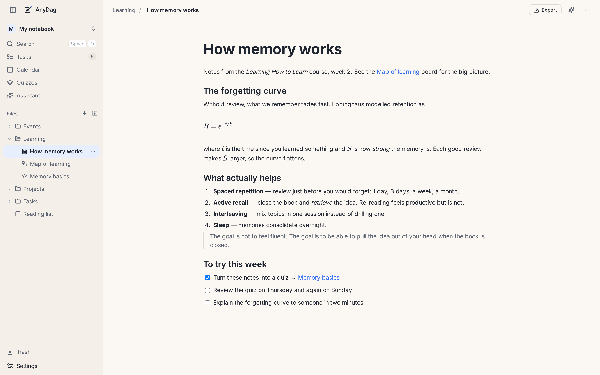
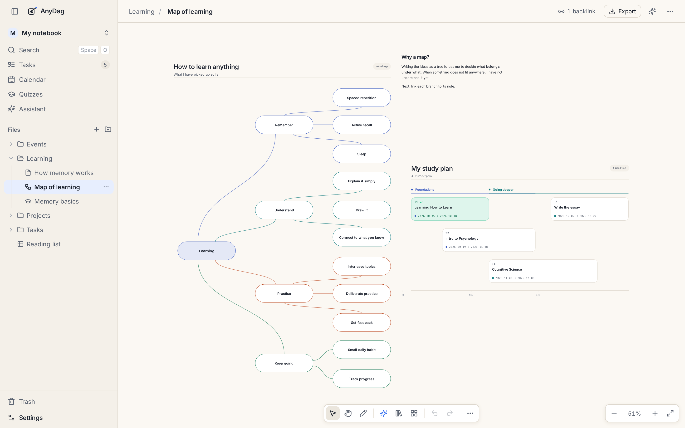
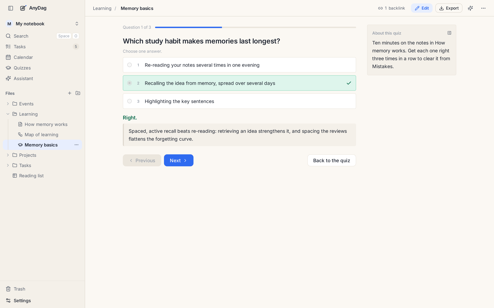
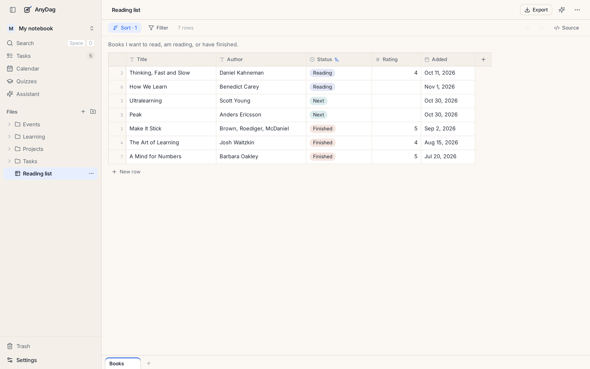
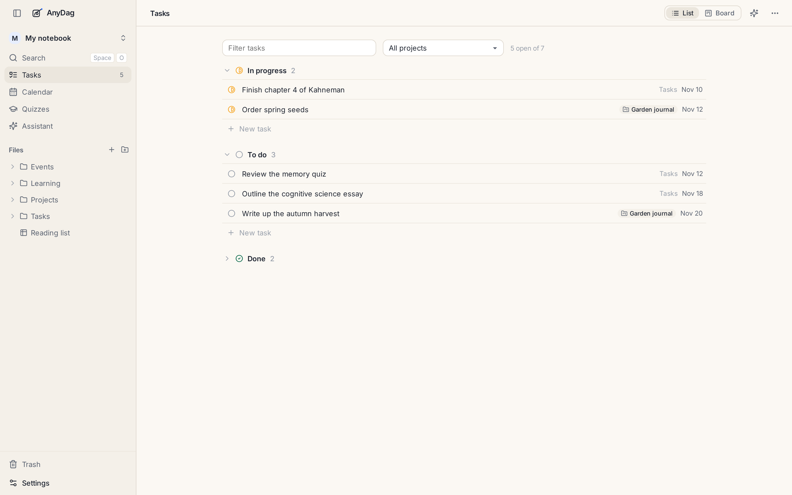
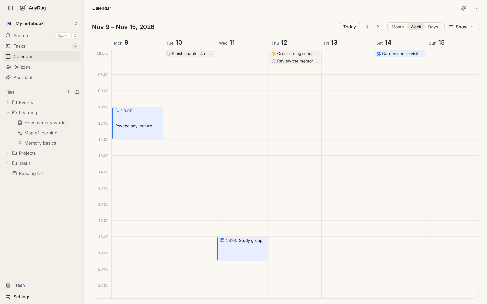
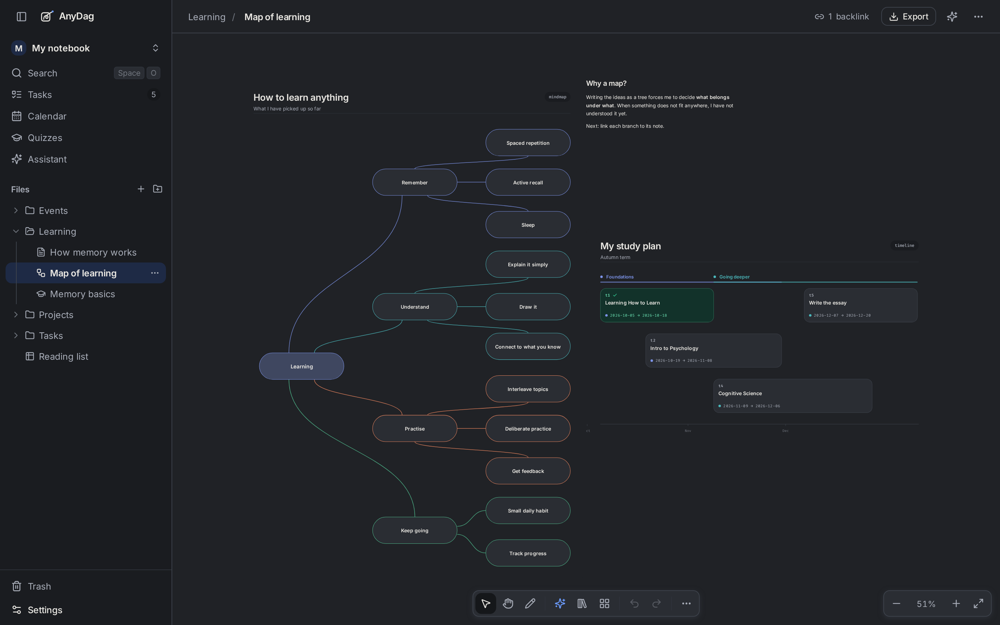
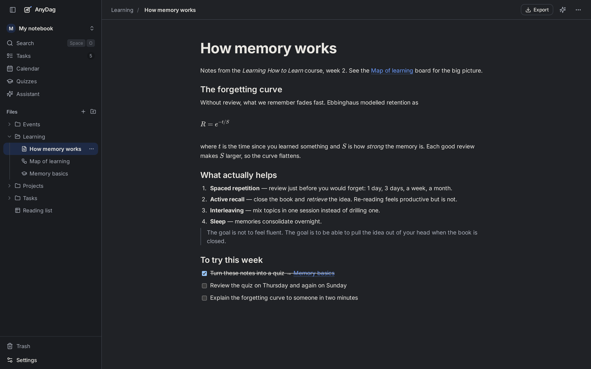

<p align="center">
  <picture>
    <source media="(prefers-color-scheme: dark)" srcset="docs/assets/wordmark-dark.svg">
    
  </picture>
</p>

<p align="center">
  <strong>A private workspace to learn, grow and create.</strong><br>
  Notes, mind maps, quizzes, tables, tasks and a calendar, all in one desktop app.<br>
  Your work stays in a folder on your computer, as plain files. No account, no cloud.
</p>

<p align="center">
  <a href="https://anydag.com"><strong>anydag.com</strong></a> ·
  <a href="https://github.com/mouhcineToumi/anydag/releases/latest">Download</a> ·
  <a href="docs/guide/getting-started.md">Getting started</a> ·
  <a href="docs/guide/README.md">Guide</a>
</p>

<p align="center">
  <a href="https://github.com/mouhcineToumi/anydag/releases/latest"></a>
  <a href="https://github.com/mouhcineToumi/anydag/actions/workflows/ci.yml"></a>
  <a href="LICENSE"></a>
</p>

<picture>
  <source media="(prefers-color-scheme: dark)" srcset="docs/assets/screenshots/note-dark.png">
  
</picture>

## Why AnyDag

Learning something, or making something, takes more than one kind of page. You read and take notes,
map out how the ideas connect, test yourself until they stick, track what to do next, and keep the
sources together. Most people spread that across four or five apps.

AnyDag keeps it in one place, and every piece links to every other:

- **Write** notes, with headings, checklists, equations, pictures and PDFs.
- **Connect** them with `[[links]]` that survive renames, and see what links back to each page.
- **Think visually** on an infinite canvas: mind maps, timelines, flowcharts and charts that lay
  themselves out.
- **Remember** what you learn with quizzes made from your notes and a Mistakes list that brings back
  what you got wrong.
- **Organise** reading lists and trackers in tables, and plans in tasks, projects and a calendar.
- **Bring your own AI**, if you want it: ask questions about your notes, or have it draft a quiz or
  a diagram, using your own Claude Code, OpenCode or API key.

It is for students, self-learners, researchers, writers, and anyone who keeps notes and wants them to
add up to something.

## A look around

**Map out a subject.** A board holds mind maps, timelines, notes and pictures side by side, and
the diagrams arrange themselves.

<picture>
  <source media="(prefers-color-scheme: dark)" srcset="docs/assets/screenshots/board-dark.png">
  
</picture>

**Test yourself.** Turn notes into a quiz, practise it, and let Mistakes bring back the questions you
missed until you get them right.

<picture>
  <source media="(prefers-color-scheme: dark)" srcset="docs/assets/screenshots/quiz-dark.png">
  
</picture>

**Keep track.** Tables for reading lists and trackers; tasks, projects and a calendar for what comes next.

<table>
  <tr>
    <td width="50%"></td>
    <td width="50%"></td>
  </tr>
</table>

<picture>
  <source media="(prefers-color-scheme: dark)" srcset="docs/assets/screenshots/calendar-dark.png">
  
</picture>

**Light or dark.** Three themes: paper, paper-dark and neutral.

<table>
  <tr>
    <th width="50%">Light</th>
    <th width="50%">Dark</th>
  </tr>
  <tr>
    <td></td>
    <td></td>
  </tr>
  <tr>
    <td></td>
    <td></td>
  </tr>
</table>

## Your work, your files

- **Everything is a plain file** in a folder you choose: notes are Markdown, and so are boards,
  quizzes and tables. Back it up, put it in git, open it in another editor, or leave and keep it all.
- **Nothing leaves your computer** unless you ask. There is no account and no cloud.
- **Nothing is lost by accident.** Deleted files wait thirty days in the trash, and a read-only lock
  stops stray edits.

## Install

Download the file for your system from the [latest release](https://github.com/mouhcineToumi/anydag/releases/latest):

| System | File |
|---|---|
| Linux (x64) | `AnyDag-<version>.AppImage` |
| Windows (x64) | `AnyDag-Setup-<version>.exe` |
| macOS, Apple Silicon | `AnyDag-<version>-arm64.dmg` |
| macOS, Intel | `AnyDag-<version>-x64.dmg` |

**0.1.0 shipped for Linux only; the next release adds Windows and macOS.** The builds are not signed with a certificate yet, so Windows and macOS ask once before they open the
app. [Getting started](docs/guide/getting-started.md#install) has the steps for each system.

## Learn more

The [guide](docs/guide/README.md) has one page per topic:

| Topic | Read |
|---|---|
| Install, your first folder, search and shortcuts | [Getting started](docs/guide/getting-started.md) |
| Writing, linking, equations, attachments | [Notes](docs/guide/notes.md) |
| Mind maps, timelines, flowcharts, charts, sketches | [Boards and diagrams](docs/guide/boards.md) |
| Practising and the Mistakes run | [Quizzes](docs/guide/quizzes.md) |
| Reading lists, trackers, CSV | [Tables](docs/guide/tables.md) |
| To-dos, projects, events | [Tasks, projects and the calendar](docs/guide/tasks-and-calendar.md) |
| The Assistant, prompt cards, AI agents and the `anydag` command | [AI and agents](docs/guide/ai.md) |
| Your files, the trash, the lock | [Your files](docs/guide/files.md) |

## For developers

AnyDag is TypeScript, React, Hono and Electron, in one repository. With Node 24.7 or later:

```bash
npm install
npm run dev          # the app on a development vault: http://localhost:3500/?board=demo
npm run desktop:dev  # the desktop app on the same code
npm run checks       # lint, typechecks, contracts and unit tests (what every commit runs)
```

- [CONTRIBUTING.md](CONTRIBUTING.md): set-up, branches, the issue workflow and what a pull request
  needs. [AGENTS.md](AGENTS.md) is the short version for AI coding agents.
- [`docs/architecture/`](docs/architecture/README.md): how the code is built, one file per area.
- [`docs/dsl/`](docs/dsl/): the diagram language, one page per diagram type.
- [`docs/RELEASING.md`](docs/RELEASING.md): how releases and nightlies are cut.
- [SECURITY.md](SECURITY.md): report a vulnerability privately, not in an issue.
- [CODE_OF_CONDUCT.md](CODE_OF_CONDUCT.md): how we treat each other.

Issues and pull requests are welcome. Open an issue first and wait for it to be marked
`status: ready`.

## Licence

[MIT](LICENSE). The bundled icon sets keep their own licences; see `icons/NOTICE`.
