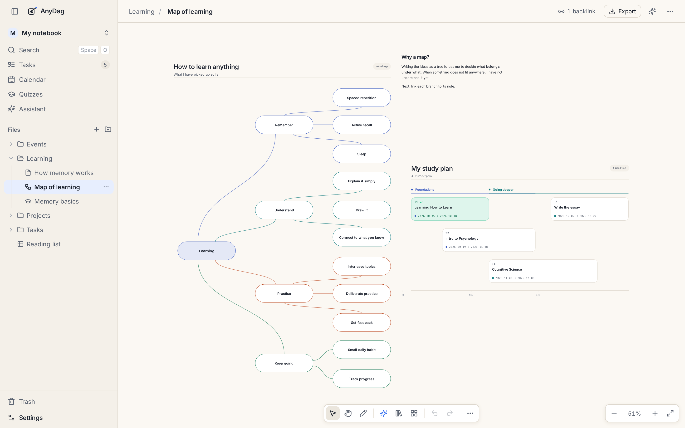

# Boards and diagrams



A board is an **infinite canvas** where notes, tables, pictures and diagrams sit side by side. Use one
to map out a subject you are learning, plan a term or a project, or think something through on a
whiteboard. A board is a file too: `Name.board.md`.

## Getting around

The mouse wheel or trackpad moves the board. Hold `ctrl` (`cmd` on a Mac) and scroll to zoom. Click
to select something, drag to move it, and drag its edge to resize it. Undo and redo are in the dock
at the bottom.

## Adding things

| To add | Do |
|---|---|
| a text card | double-click the empty canvas, or `space N` |
| a diagram, chart or shape | open the **library** (`space L`) and click or drag one onto the board |
| a picture or file | drop it on the board, or paste it |
| a note, table, quiz or task you already have | drag it from the sidebar onto the board |
| a diagram described in words | a **prompt card** (`space P`): see [AI and agents](ai.md) |

Double-click any card to edit its text where it is drawn. `space T` tidies the board so nothing
overlaps.

## Diagrams that lay themselves out

You write *what* is in a diagram and AnyDag decides *where* everything goes. A mind map, for example,
is just an indented list:

````md
```mindmap
root Learning
  Remember
    Spaced repetition
    Active recall
  Understand
    Explain it simply
```
````

There are fourteen kinds:

| For | Use |
|---|---|
| ideas and plans | `mindmap`, `timeline` |
| processes and decisions | `flow` (flowcharts and swimlanes), `activity`, `state`, `sequence` |
| data | `chart` (bar, line, pie, donut) |
| drawing freely | `sketch`: shapes, arrows and a pen, placed where you put them |
| systems and software | `arch`, `c4`, `erd`, `class`, `usecase`, `gitgraph` |

You can also pick a card inside a diagram and edit it with the pointer: retype it, change its kind,
or grow the next card with its arrow already attached. The full grammar of each kind is in
[`docs/dsl/`](../dsl/), one page per kind.

## Themes

Every board follows the app's theme: **paper** (light), **paper-dark** and **neutral**. Colours come
from the theme, never from the file, so a board looks right in all three.

## Exporting

**Export** in the top bar saves the board as an **SVG**, a **PNG** or its `.board.md` file. Select one
diagram first to export just that one.

---

[← Notes](notes.md) · [Guide](README.md) · [Quizzes →](quizzes.md)
