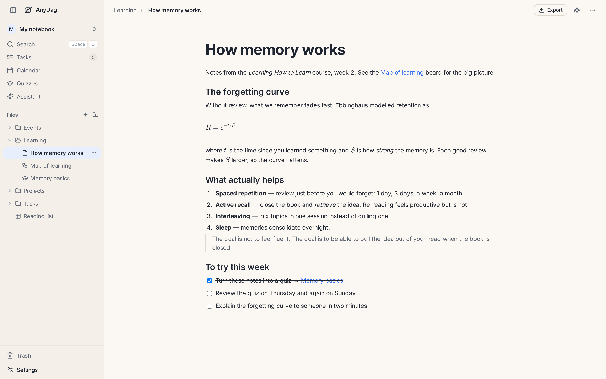

# Notes

A note is a page of writing: lecture notes, a journal entry, a plan, a summary of a book. Every note
is a Markdown file (`Name.md`) in your folder, so it stays readable in any other editor.

## Writing

Notes open in a **block editor**. Type as you would in any document, or use Markdown as you type:
`#` for a heading, `-` for a list, `[]` for a checklist, `>` for a quote, three backticks for code.
Type `/` at the start of a line for the menu of everything you can insert. Drag a block by its
handle to move it.

Saving is automatic. AnyDag rewrites only the paragraph you changed, so a note written by hand or by
another app keeps its formatting.

## Linking notes together

Type `[[` and the name of another note, board, quiz or table to link to it. Links are kept by an
id, not by name, so **renaming or moving a file never breaks a link to it**. Settings → This vault → Files and images decides
whether a rename also updates the `[[wikilinks]]` that name it.

Each document lists its **backlinks**, the other documents that link to it, in its top bar. Over
time this turns a pile of notes into a web you can walk.

You can also **embed** a board, a table, a quiz, a task or a picture inside a note: it is drawn in
place and stays live.

## Equations

Write TeX between dollar signs:

| Write | Get |
|---|---|
| `$E = mc^2$` | an equation inside the line |
| `$$` on a line, the TeX, then `$$` on a line | an equation on its own, centred |

`ctrl+shift+E` inserts an equation where the cursor is.

## Pictures and files

Paste a screenshot, drop a file from your computer onto the note, or use `/` → *Upload file*. The
file is kept in your folder's `attachments/` and shown in the note: pictures inline, PDFs, audio and
video as a card you can open in place.

## Tasks and events are notes too

Turn any note into a task (the `⋯` menu → *Make it a task*) and it gets a status and a due date. A
note with a start time is an event on the calendar. See [Tasks, projects and the calendar](tasks-and-calendar.md).

## Exporting

**Export** in the top bar saves the note as a **PDF** or as its Markdown file. A note with pictures
or attachments saves as a zip with them inside.

---

[← Getting started](getting-started.md) · [Guide](README.md) · [Boards and diagrams →](boards.md)
