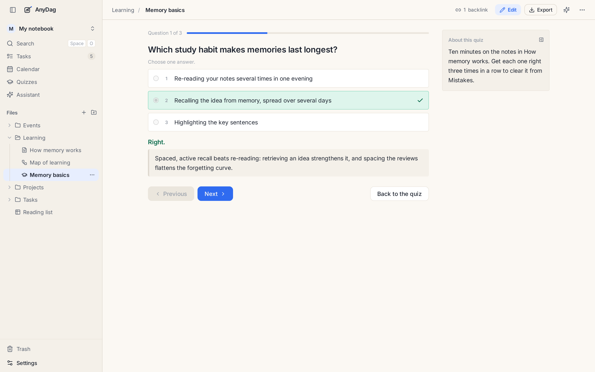

# Quizzes

Reading your notes again feels like studying, but testing yourself is what makes things stick. A quiz
turns what you wrote into questions you answer from memory. Each quiz is a file, `Name.quiz.md`.

## Making a quiz

**+** in the sidebar → *Quiz*, or the box on the **Quizzes** page. Each question has:

- the question, and optionally more detail: a code sample, a picture, an equation;
- its options, with the right ones ticked. Tick several and the quiz asks for every right answer;
- an explanation, shown once you have answered.

You can also add an **open question**: you write your answer, then compare it with the model answer
and mark yourself right or wrong.

*Shuffle the options* changes their order on every run; pin an option (such as "All of the above")
to keep it where it is. The **Source** tab shows the quiz as the Markdown file it is.

An AI agent or the Assistant can write a quiz from your notes for you: see [AI and agents](ai.md).

## Practising

**Practice** runs the quiz one question at a time. Press `1`–`9` to pick an answer and Enter to go
on, or use the arrow keys to move without answering.

## Mistakes

Every question you get wrong goes into **Mistakes**, on the Quizzes page. Practise Mistakes and a
question leaves once you get it right a few times in a row, twice by default (Settings → You → Quizzes
sets it between 1 and 10). This is spaced practice without the bookkeeping.

You can also practise **every quiz in a folder** as one run: the folder's menu in the sidebar →
*Practice the quizzes*.

A quiz can be embedded in a note or on a board as a card with a Practice button.

---

[← Boards and diagrams](boards.md) · [Guide](README.md) · [Tables →](tables.md)
