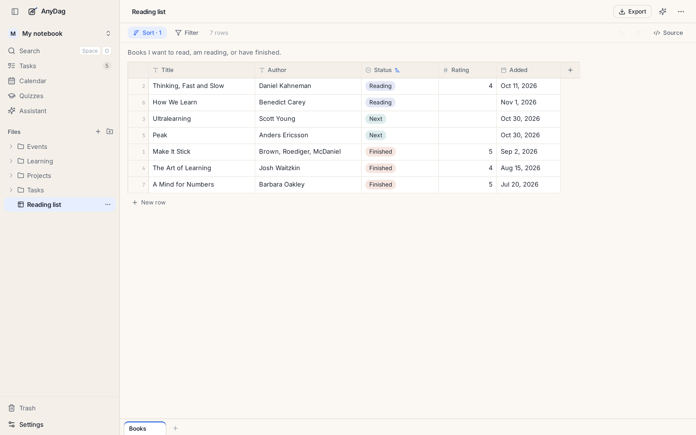

# Tables

A table is for anything you keep in rows: a reading list, a habit tracker, vocabulary, a list of
applications, a budget. Each table is a file, `Name.table.md`, written as a plain Markdown table so
any editor can read it.

## Columns

Each column has a type, which decides how its cells are shown, sorted and edited:

| Type | Holds |
|---|---|
| text | anything |
| number | a number, right-aligned |
| date | a day, written `YYYY-MM-DD` and shown as words |
| select | one of a list of options, shown as a coloured tag |
| checkbox | ticked or not |
| link | a web address, or a link to another note or document in your folder |

Changing a column's type never changes what is in its cells. A cell the new type cannot read is
underlined in red so you can fix it.

## Working with rows

Click a cell to edit it. **New row** adds one at the bottom, and you can drag rows to reorder them.
**Sort** and **Filter** in the bar above the grid change what you see, not the file's order, and they
are remembered with the table.

A table can have several **tabs**, along the bottom, each its own grid.

## Import and export

**Import CSV** brings in a spreadsheet: the separator and each column's type are guessed for you.
**Export** saves a tab as CSV or the whole table as its Markdown file.

A table can be embedded in a note or on a board, where it shows its first rows and opens on a
double-click.

---

[← Quizzes](quizzes.md) · [Guide](README.md) · [Tasks, projects and the calendar →](tasks-and-calendar.md)
