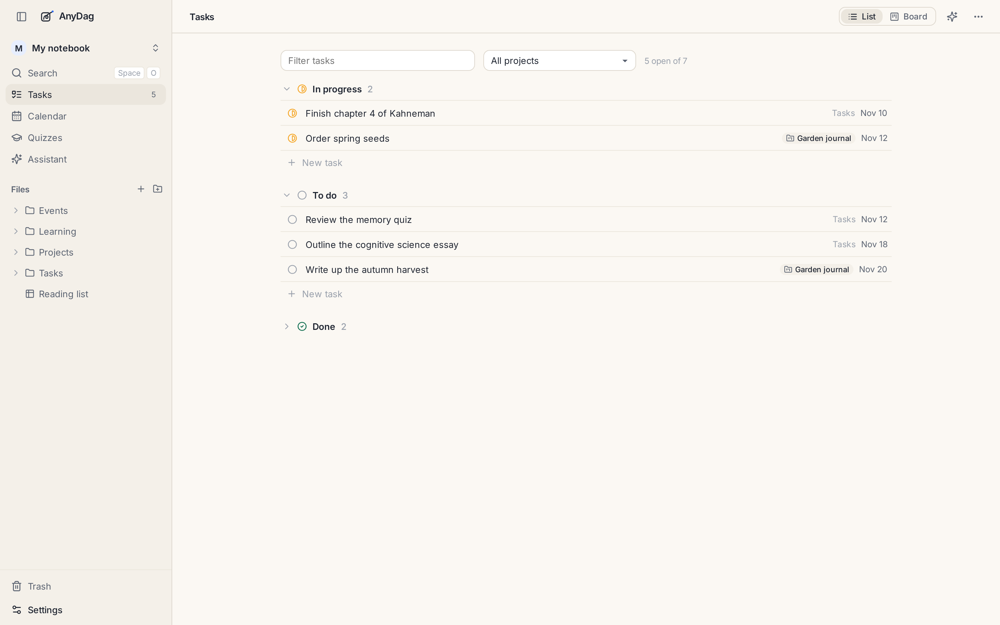
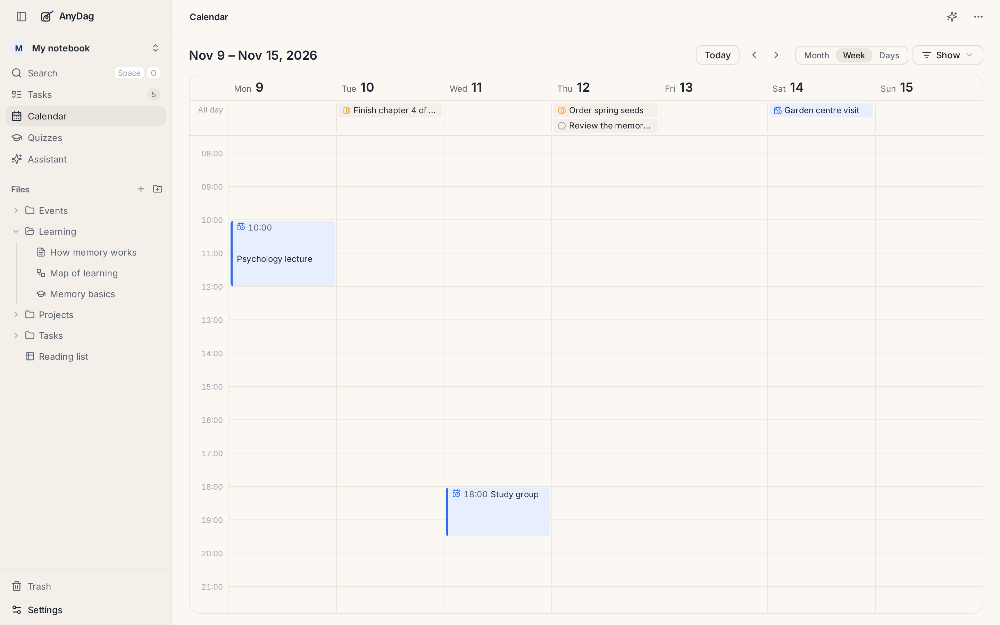

# Tasks, projects and the calendar

Tasks, projects and events are not a separate app bolted on. Each one is a note with a line or two at
the top, so a task can hold all the notes, links and pictures it needs.

## Tasks

A task has a **status** (to do, in progress, done) and optionally a **due date**. To make one:

- **Tasks** in the sidebar, then type in the box under any group; or
- the `⋯` menu of any note → *Make it a task*.

The **Tasks page** shows every task in the vault, either as a list grouped by status or as a board of
three columns you drag cards between. Filter by words or by project. The number beside **Tasks** in
the sidebar is how many are still open.

A task can sit on a board or inside a note as a card whose status you can change with a click.

## Projects

A project is a **folder** with a project note in it: a status (active, paused or done) and a colour.
Everything in the folder belongs to the project, and its tasks are tagged with it on the Tasks page.

## Events and the calendar

A note with a start time is an **event**: a lecture, a meeting, a trip. A date alone makes it an
all-day event.

The **Calendar** shows events and the tasks that are due by month, by week or as a few days. Drag an
event to move it. **Show** chooses what is drawn. Settings → Calendar sets your time zone and the
day a week starts on.

---

[← Tables](tables.md) · [Guide](README.md) · [AI and agents →](ai.md)
